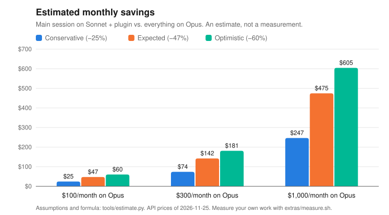

# model-router per Claude Code

**Spendi meno con Claude Code senza lasciare la tua unica chat.** Haiku legge, Sonnet scrive codice, Opus ragiona, e la sessione principale affida ogni sotto-compito al modello più economico che sa ancora farlo bene.

[English](README.md) · Licenza MIT · Plugin per Claude Code

<picture>
  <source media="(prefers-color-scheme: dark)" srcset="docs/savings-dark.svg">
  
</picture>

> **Il grafico è una stima, non una misura.** Si basa sui prezzi ufficiali delle API e su ipotesi dichiarate ([come è calcolato](#come-è-calcolata-la-stima)). Il risparmio reale dipende dai tuoi compiti: [misuralo](#misura-il-tuo-risparmio).

## Perché

Una chat di Claude Code non può cambiare il proprio modello a metà. Però può delegare lavoro a dei **subagent**, e ogni subagent può girare su un modello fisso. Questo plugin ne aggiunge tre, più una breve policy che dice alla sessione principale quando usarli:

| Agente | Modello | Per cosa | Restituisce |
|---|---|---|---|
| `model-router:reader` | Haiku | esplorazione in sola lettura: trovare codice, seguire un flusso, riassumere file, log e documentazione | conclusioni + `file:riga` |
| `model-router:coder` | Sonnet | implementare una modifica ben definita e i suoi test | breve resoconto di cosa è cambiato e cosa è stato verificato |
| `model-router:architect` | Opus | progettazione, trade-off, piani su più file, bug difficili, sicurezza | una decisione e un piano passo per passo (non modifica mai i file) |

La policy viene iniettata una volta a inizio sessione (e di nuovo dopo `/clear` o una compattazione). È di circa 160 parole, non un promemoria a ogni messaggio. Contiene tre regole:

- **I passi piccoli restano nella sessione principale.** Ogni subagent parte da zero, quindi delegare una cosa minima costa più che farla.
- **Se un agente fallisce si sale di un livello** (reader → coder → architect), invece di riprovare con lo stesso agente.
- **Brief e risposte restano brevi.** Gli agenti restituiscono conclusioni, non file interi, così il contesto principale resta piccolo.

## Installazione

Serve Claude Code con supporto ai plugin.

```bash
claude plugin marketplace add dimakushniriuk-art/claude-code-model-router
claude plugin install model-router@model-router
```

Oppure dentro Claude Code: `/plugin marketplace add dimakushniriuk-art/claude-code-model-router` e poi `/plugin install model-router@model-router`.

Riavvia Claude Code e lancia `/agents`: devi vedere i tre agenti `model-router:*`.

**Poi imposta Sonnet come modello principale.** Usa `/model sonnet`, oppure aggiungi `"model": "sonnet"` in `~/.claude/settings.json`. È la leva più grande: la conversazione gira su Sonnet, e Opus entra tramite `architect` solo quando il lavoro lo richiede. Se tieni Opus come modello principale, il plugin sposta comunque le letture su Haiku, ma il risparmio stimato scende a circa il 13%.

Per provarlo senza installarlo, clona il repository e lancia `claude --plugin-dir ./plugins/model-router`.

## Extra opzionali

**Status line.** Mostra modello, costo della sessione, contesto usato e cache hit, per esempio `Sonnet 5.5 | $0.12 | ctx 37% | cache 91%`. I plugin non possono impostare la status line, quindi va fatto a mano, e serve `jq`.

```bash
cp extras/statusline.sh ~/.claude/statusline.sh && chmod +x ~/.claude/statusline.sh
```

```jsonc
// ~/.claude/settings.json
{ "statusLine": { "type": "command", "command": "~/.claude/statusline.sh" } }
```

**Regole per CLAUDE.md.** [`extras/CLAUDE.md-snippet.md`](extras/CLAUDE.md-snippet.md) contiene regole generali per risparmiare token e istruzioni di compattazione. Incollalo in `~/.claude/CLAUDE.md`.

## Misura il tuo risparmio

Lancia questo comando dentro un qualsiasi repository git:

```bash
bash extras/measure.sh "un compito che fai davvero, es. aggiungi la validazione al form di registrazione" 3
```

Esegue lo stesso compito 3 volte per variante, ognuna in un worktree git usa e getta, così la tua cartella di lavoro non viene mai toccata:

- **baseline:** Opus come modello principale, tutti i subagent forzati su Opus (nessun routing)
- **routed:** Sonnet come modello principale, con il plugin

Per ogni run stampa costo, turni, durata e costo per modello. Puoi cambiare i modelli con `BASE_MODEL` e `ROUTED_MODEL`. Per compiti che lanciano test usa `PERM=auto`, perché `acceptEdits` nega i comandi shell in modalità non interattiva. **Confronta anche la qualità dei due risultati, non solo il prezzo.**

Puoi misurare anche a mano: fai lo stesso compito in due sessioni e confronta `/usage` alla fine.

Un dato reale: su un repository giocattolo di 5 file, con una sola run di un compito di ricerca, il costo è stato di **0,23 $ in baseline e 0,085 $ con il routing**. Quasi tutto il risparmio veniva da Sonnet al posto di Opus come modello principale, non da Haiku. Una sola run su un repository giocattolo non dimostra nulla sul tuo carico di lavoro.

## Come è calcolata la stima

È tutto in [`tools/estimate.py`](tools/estimate.py), senza dipendenze. Modifica le ipotesi e lancia `python3 tools/estimate.py` per ridisegnare il grafico.

**Prezzi** (USD per milione di token, [pagina ufficiale dei prezzi](https://platform.claude.com/docs/en/about-claude/pricing), verificati il 25/11/2026):

| Modello | Input | Scrittura cache (5m) | Lettura cache | Output |
|---|---|---|---|---|
| Opus 5.5 | 4,00 | 5,00 | 0,20 | 20,00 |
| Sonnet 5.5 | 2,00 | 2,50 | 0,10 | 10,00 |
| Haiku 5.5 (prompt ≤100K) | 0,10 | 0,125 | 0,01 | 0,50 |

**Ipotesi 1, composizione dei token.** Le sessioni agentiche rimandano il proprio contesto, quindi i token sono per l'85% letture dalla cache, 5% scritture in cache, 3% input nuovo e 7% output. Con questa composizione Sonnet costa 0,50× Opus (esattamente la metà in ogni voce) e Haiku circa 0,027× Opus.

**Ipotesi 2, chi fa il lavoro.** La baseline è tutto su Opus. Le quote sono dei token della baseline, e l'overhead sono i token in più per l'avvio a freddo dei subagent, i brief e i riassunti:

| Scenario | Sonnet | Haiku | Opus | Overhead | Risparmio | a 100 $/mese | a 300 $/mese | a 1.000 $/mese |
|---|---|---|---|---|---|---|---|---|
| Prudente | 60% | 10% | 30% | +25% | 25% | 25 $ | 74 $ | 247 $ |
| Atteso | 60% | 25% | 15% | +15% | 47% | 47 $ | 142 $ | 475 $ |
| Ottimista | 60% | 35% | 5% | +10% | 60% | 60 $ | 181 $ | 605 $ |
| Opus principale + plugin | – | 25% | 75% | +15% | 13% | 13 $ | 39 $ | 130 $ |

Formula: `costo con routing = baseline × (Σ quota × prezzo relativo) × (1 + overhead)`.

**Cosa la stima non considera.**
- **Una qualità più bassa ha un costo.** Se Sonnet o Haiku sbagliano e devi rifare il lavoro, il risparmio si riduce. Per questo la policy sale a un modello più forte quando un agente fallisce.
- **Il contesto che la sessione principale non legge più non è conteggiato.** Aumenterebbe il risparmio, quindi su questo punto la stima è prudente.
- **Abbonamenti.** Con un piano Pro o Max paghi una quota fissa, quindi il risparmio non ti torna in denaro: si traduce in più lavoro prima di raggiungere i limiti di utilizzo. Le cifre in dollari valgono per la fatturazione API a consumo.
- **Haiku 5.5 costa 5 volte di più per prompt sopra i 100K token.** Normalmente il reader resta molto al di sotto.

## Personalizzazione

- Cambia `model:` in [`plugins/model-router/agents/*.md`](plugins/model-router/agents) se un agente fatica, per esempio `reader: sonnet`. Valori accettati: `haiku`, `sonnet`, `opus`, `fable`, `inherit` o un ID completo.
- Modifica la policy di delega in [`plugins/model-router/hooks/routing-policy.md`](plugins/model-router/hooks/routing-policy.md).
- Disattiva tutto con `/plugin`, oppure con `claude plugin disable model-router`.

## Riferimenti

Documentazione di Claude Code: [subagent](https://code.claude.com/docs/en/sub-agents) · [plugin](https://code.claude.com/docs/en/plugins-reference) · [hook](https://code.claude.com/docs/en/hooks) · [status line](https://code.claude.com/docs/en/statusline) · [gestione dei costi](https://code.claude.com/docs/en/costs) · [prezzi API](https://platform.claude.com/docs/en/about-claude/pricing)

Progetto della community, non affiliato ad Anthropic né approvato da Anthropic.

## Licenza

[MIT](LICENSE)
