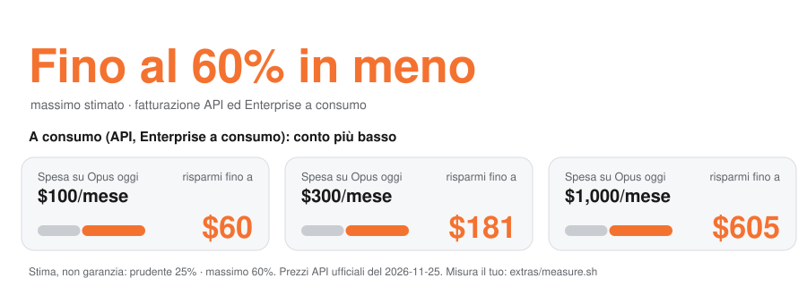
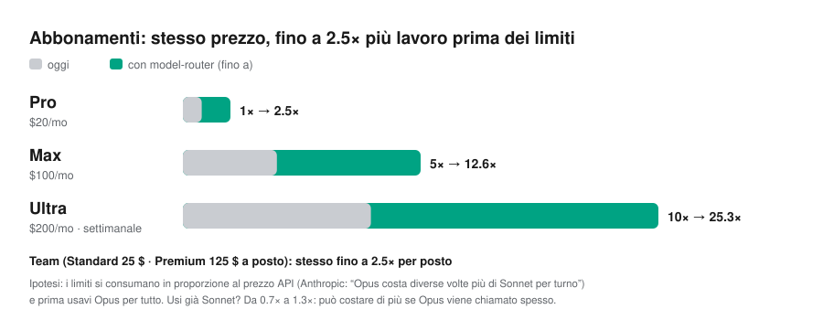
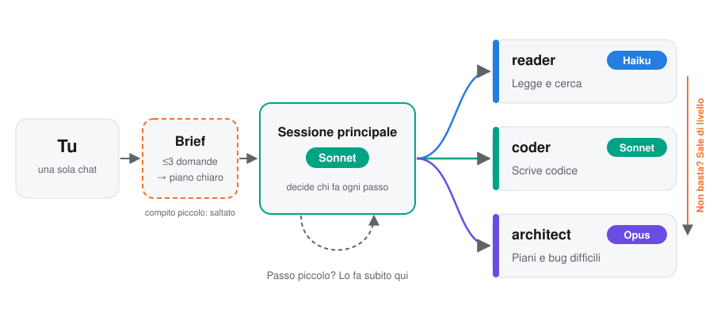
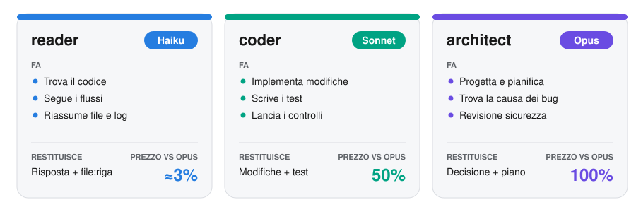
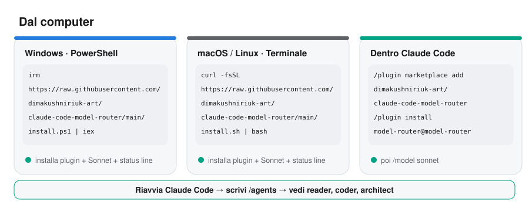
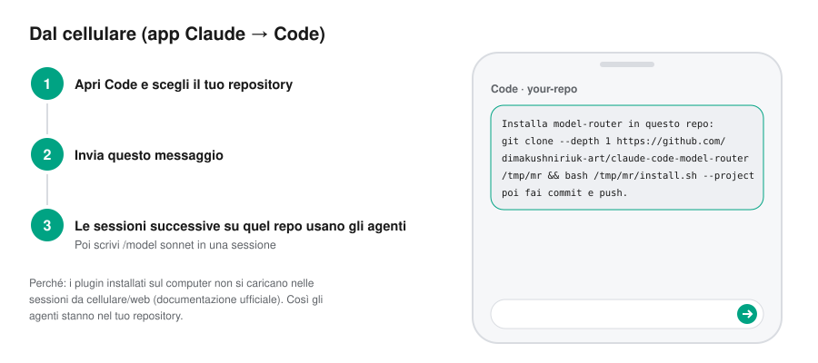

# model-router per Claude Code

**Stessa chat, conto più basso.** Haiku legge, Sonnet scrive codice, Opus ragiona.

[English](README.md) · [Tutti i dettagli](docs/DETAILS.it.md) · MIT

<picture><source media="(prefers-color-scheme: dark)" srcset="docs/img/money-it-dark.svg"></picture>

<picture><source media="(prefers-color-scheme: dark)" srcset="docs/img/plans-it-dark.svg"></picture>

## Come funziona

<picture><source media="(prefers-color-scheme: dark)" srcset="docs/img/flow-it-dark.svg"></picture>

<picture><source media="(prefers-color-scheme: dark)" srcset="docs/img/brief-it-dark.svg"></picture>

<picture><source media="(prefers-color-scheme: dark)" srcset="docs/img/agents-it-dark.svg"></picture>

## Installazione

<picture><source media="(prefers-color-scheme: dark)" srcset="docs/img/install-pc-it-dark.svg"></picture>

```powershell
# Windows · PowerShell
irm https://raw.githubusercontent.com/dimakushniriuk-art/claude-code-model-router/main/install.ps1 | iex
```

```bash
# macOS / Linux · Terminale
curl -fsSL https://raw.githubusercontent.com/dimakushniriuk-art/claude-code-model-router/main/install.sh | bash
```

<picture><source media="(prefers-color-scheme: dark)" srcset="docs/img/install-phone-it-dark.svg"></picture>

```text
Installa model-router in questo repo: git clone --depth 1 https://github.com/dimakushniriuk-art/claude-code-model-router /tmp/mr && bash /tmp/mr/install.sh --project, poi fai commit e push.
```

> Tutti i risparmi sono stime, non garanzie. [Come sono calcolati](docs/DETAILS.it.md#come-è-calcolata-la-stima) · [Misura il tuo risparmio](docs/DETAILS.it.md#misura-il-tuo-risparmio) · Progetto della community, non affiliato ad Anthropic.
