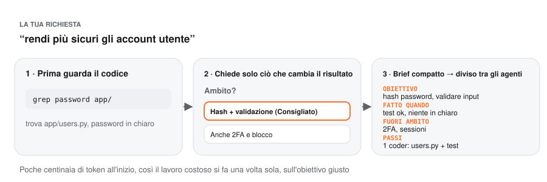
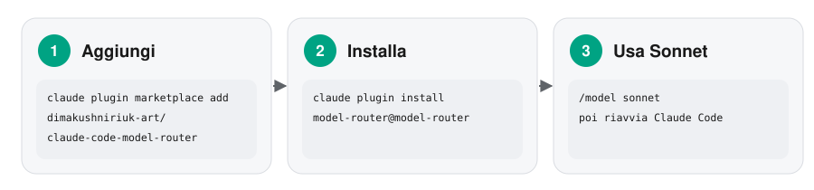
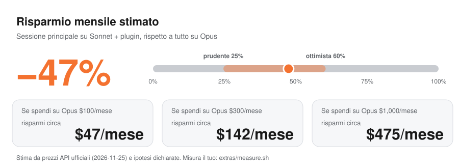

# model-router per Claude Code

**Stessa chat, conto più basso.** Haiku legge, Sonnet scrive codice, Opus ragiona.

[English](README.md) · [Tutti i dettagli](docs/DETAILS.it.md) · MIT

<picture><source media="(prefers-color-scheme: dark)" srcset="docs/img/flow-it-dark.svg"></picture>

<picture><source media="(prefers-color-scheme: dark)" srcset="docs/img/brief-it-dark.svg"></picture>

<picture><source media="(prefers-color-scheme: dark)" srcset="docs/img/agents-it-dark.svg"></picture>

<picture><source media="(prefers-color-scheme: dark)" srcset="docs/img/install-it-dark.svg"></picture>

```bash
claude plugin marketplace add dimakushniriuk-art/claude-code-model-router
claude plugin install model-router@model-router
```

<picture><source media="(prefers-color-scheme: dark)" srcset="docs/img/savings-it-dark.svg"></picture>

> Stima, non misura. [Come è calcolata](docs/DETAILS.it.md#come-è-calcolata-la-stima) · [Misura il tuo risparmio](docs/DETAILS.it.md#misura-il-tuo-risparmio) · Con i piani Pro/Max il risparmio significa più utilizzo prima dei limiti, non denaro.
