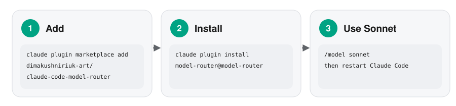
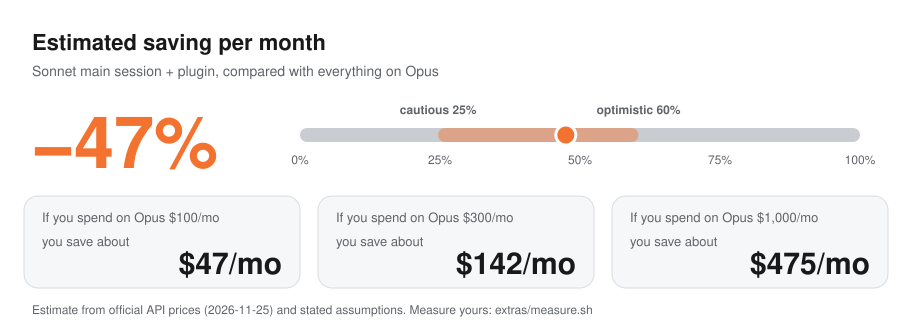

# model-router for Claude Code

**Same single chat, lower bill.** Haiku reads, Sonnet codes, Opus thinks.

[Italiano](README.it.md) · [Full details](docs/DETAILS.md) · MIT

<picture><source media="(prefers-color-scheme: dark)" srcset="docs/img/flow-en-dark.svg"></picture>

<picture><source media="(prefers-color-scheme: dark)" srcset="docs/img/brief-en-dark.svg"></picture>

<picture><source media="(prefers-color-scheme: dark)" srcset="docs/img/agents-en-dark.svg"></picture>

<picture><source media="(prefers-color-scheme: dark)" srcset="docs/img/install-en-dark.svg"></picture>

```bash
claude plugin marketplace add dimakushniriuk-art/claude-code-model-router
claude plugin install model-router@model-router
```

<picture><source media="(prefers-color-scheme: dark)" srcset="docs/img/savings-en-dark.svg"></picture>

> Estimate, not a measurement. [How it is computed](docs/DETAILS.md#how-the-estimate-is-computed) · [Measure your own](docs/DETAILS.md#measure-your-own-savings) · On Pro/Max plans the saving means more usage before limits, not money back.
