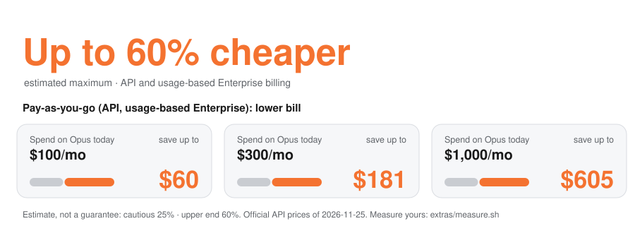
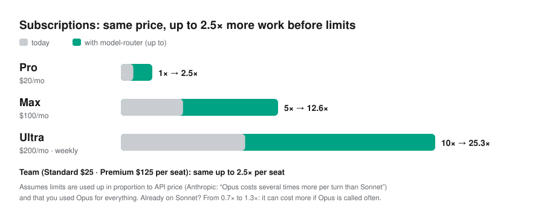
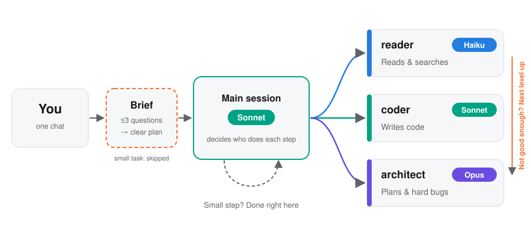
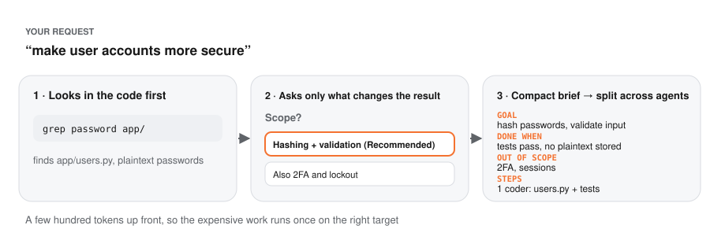
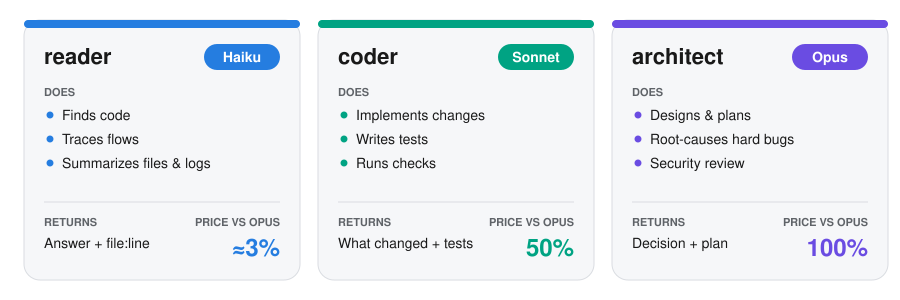
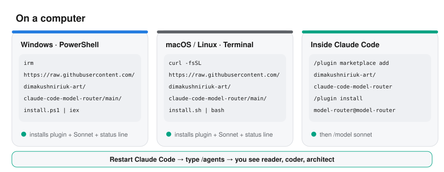
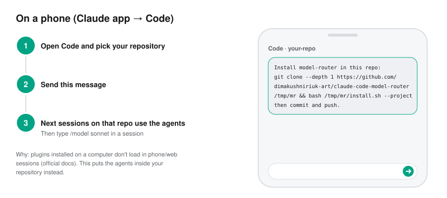

# model-router for Claude Code

**Same single chat, lower bill.** Haiku reads, Sonnet codes, Opus thinks.

[Italiano](README.it.md) · [Full details](docs/DETAILS.md) · MIT

<picture><source media="(prefers-color-scheme: dark)" srcset="docs/img/money-en-dark.svg"></picture>

<picture><source media="(prefers-color-scheme: dark)" srcset="docs/img/plans-en-dark.svg"></picture>

## How it works

<picture><source media="(prefers-color-scheme: dark)" srcset="docs/img/flow-en-dark.svg"></picture>

<picture><source media="(prefers-color-scheme: dark)" srcset="docs/img/brief-en-dark.svg"></picture>

<picture><source media="(prefers-color-scheme: dark)" srcset="docs/img/agents-en-dark.svg"></picture>

## Install

<picture><source media="(prefers-color-scheme: dark)" srcset="docs/img/install-pc-en-dark.svg"></picture>

```powershell
# Windows · PowerShell
irm https://raw.githubusercontent.com/dimakushniriuk-art/claude-code-model-router/main/install.ps1 | iex
```

```bash
# macOS / Linux · Terminal
curl -fsSL https://raw.githubusercontent.com/dimakushniriuk-art/claude-code-model-router/main/install.sh | bash
```

<picture><source media="(prefers-color-scheme: dark)" srcset="docs/img/install-phone-en-dark.svg"></picture>

```text
Install model-router in this repo: git clone --depth 1 https://github.com/dimakushniriuk-art/claude-code-model-router /tmp/mr && bash /tmp/mr/install.sh --project, then commit and push.
```

> All savings are estimates, not guarantees. [How they are computed](docs/DETAILS.md#how-the-estimate-is-computed) · [Measure your own](docs/DETAILS.md#measure-your-own-savings) · Community project, not affiliated with Anthropic.
