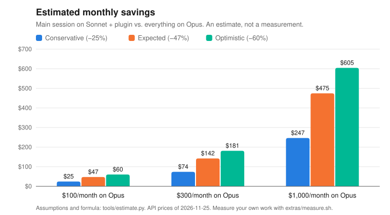

# model-router: tutti i dettagli

[← Torna al README](../README.it.md) · [English](DETAILS.md)


<picture>
  <source media="(prefers-color-scheme: dark)" srcset="savings-dark.svg">
  
</picture>

> **Il grafico è una stima, non una misura.** Si basa sui prezzi ufficiali delle API e su ipotesi dichiarate ([come è calcolato](#come-è-calcolata-la-stima)). Il risparmio reale dipende dai tuoi compiti: [misuralo](#misura-il-tuo-risparmio).

## Perché

Una chat di Claude Code non può cambiare il proprio modello a metà. Però può delegare lavoro a dei **subagent**, e ogni subagent può girare su un modello fisso. Questo plugin ne aggiunge tre, più una breve policy che dice alla sessione principale quando usarli:

| Agente | Modello | Per cosa | Restituisce |
|---|---|---|---|
| `model-router:reader` | Haiku | esplorazione in sola lettura: trovare codice, seguire un flusso, riassumere file, log e documentazione | conclusioni + `file:riga` |
| `model-router:coder` | Sonnet | implementare una modifica ben definita e i suoi test | breve resoconto di cosa è cambiato e cosa è stato verificato |
| `model-router:architect` | Opus | progettazione, trade-off, piani su più file, bug difficili, sicurezza | una decisione e un piano passo per passo (non modifica mai i file) |

La policy viene iniettata una volta a inizio sessione (e di nuovo dopo `/clear` o una compattazione). È di circa 200 parole, non un promemoria a ogni messaggio. Contiene tre regole:

- **I passi piccoli restano nella sessione principale.** Ogni subagent parte da zero, quindi delegare una cosa minima costa più che farla.
- **Se un agente fallisce si sale di un livello** (reader → coder → architect), invece di riprovare con lo stesso agente.
- **Brief e risposte restano brevi.** Gli agenti restituiscono conclusioni, non file interi, così il contesto principale resta piccolo.

## La fase brief

Per richieste medie o grandi (più file o più passi) e per quelle vaghe, la sessione principale usa prima la skill `model-router:brief`. Puoi anche chiamarla tu: `/model-router:brief <la tua richiesta>`.

1. **Guarda prima di chiedere.** Due o tre ricerche rapide rispondono a tutto ciò che il codice può dire: framework, convenzioni, comando dei test, posizione dei file.
2. **Fa al massimo 3 domande, in un solo giro**, e solo se la risposta cambia cosa viene costruito o come si verifica: ambito, comportamento visibile, contratti di dati o API, sicurezza, passi irreversibili. Ogni domanda ha un'opzione consigliata. Stile e nomi li decide e li elenca come ipotesi. In modalità non interattiva non si blocca mai: sceglie le opzioni consigliate e le elenca.
3. **Scrive un brief di circa 12 righe**: OBIETTIVO, CONTESTO, VINCOLI, FATTO QUANDO, FUORI AMBITO, IPOTESI e PASSI, con ogni passo assegnato a `self`, `reader`, `coder` o `architect`. Lo stesso brief viene passato a ogni agente, così gli agenti non riesplorano.
4. **Le richieste piccole, chiare o di continuazione la saltano del tutto.** Nei compiti grandi o difficili da annullare, se ci sono ipotesi, chiede "Procedo con questo brief?" nello stesso unico giro.

**Fa davvero risparmiare? I conti onesti.** Un brief costa circa 300–800 token in più e, a volte, un breve giro di domande. Su Sonnet è meno di un centesimo di dollaro. Un tentativo nella direzione sbagliata su un compito medio (esplorare, modificare e testare la cosa sbagliata, poi rifarla) consuma di solito decine di migliaia di token. Quindi il brief si ripaga anche se evita il lavoro rifatto solo in una piccola parte dei compiti medi, e la lista FATTO QUANDO evita anche le funzionalità in più che nessuno ha chiesto. Entrambi gli effetti sono plausibili ma **non ancora misurati**, quindi non sono nel grafico del risparmio. In un test con la richiesta vaga "rendi più sicuri gli account utente", la run con il brief ha elencato le ipotesi e limitato l'ambito (hash + validazione). Quella senza brief ha aggiunto blocco dell'account e una policy password rigida non richiesti. Il costo totale è stato simile (0,15 $ contro 0,12 $) su quel repository minuscolo. Per misurarlo sul tuo lavoro, lancia `extras/measure.sh` con un compito volutamente vago.

## Installazione

**Windows (PowerShell):**

```powershell
irm https://raw.githubusercontent.com/dimakushniriuk-art/claude-code-model-router/main/install.ps1 | iex
```

**macOS / Linux (Terminale):**

```bash
curl -fsSL https://raw.githubusercontent.com/dimakushniriuk-art/claude-code-model-router/main/install.sh | bash
```

Entrambi gli script installano il plugin, impostano Sonnet come modello principale nel tuo `settings.json` utente (prima ne salvano una copia) e installano la status line. Con `MR_SKIP_MODEL=1` o `MR_SKIP_STATUSLINE=1` salti un passo. Nota: lo script PowerShell è stato controllato leggendolo, non eseguito, perché quando è stato scritto non c'era un computer Windows disponibile. Segnala eventuali problemi.

**A mano, dentro Claude Code:** `/plugin marketplace add dimakushniriuk-art/claude-code-model-router`, poi `/plugin install model-router@model-router`, poi `/model sonnet`.

Riavvia Claude Code e scrivi `/agents`: devi vedere `model-router:reader`, `coder` e `architect`.

**Dal cellulare (app Claude → Code), o Claude Code sul web.** Queste sessioni girano nel cloud. La documentazione ufficiale dice che non caricano i plugin installati sul tuo computer, né quelli che un repository attiva in `.claude/settings.json`. Caricano invece `.claude/agents/`, `.claude/skills/` e `CLAUDE.md` del repository. Per questo la modalità progetto copia gli agenti e la skill brief nel tuo repository e aggiunge la policy di routing al suo `CLAUDE.md`. Apri Code nell'app Claude, scegli il tuo repository e invia:

```text
Installa model-router in questo repo: git clone --depth 1 https://github.com/dimakushniriuk-art/claude-code-model-router /tmp/mr && bash /tmp/mr/install.sh --project, poi fai commit e push.
```

Le nuove sessioni su quel repository avranno `reader`, `coder`, `architect` e la skill `brief`. Usa `/model sonnet` in una sessione. Lo stesso comando funziona anche dal computer, in qualsiasi repository, se vuoi condividere la configurazione con il team tramite git.

## Extra opzionali

**Status line.** Mostra modello, costo della sessione, contesto usato e cache hit, per esempio `Sonnet 5.5 | $0.12 | ctx 37% | cache 91%`. I plugin non possono impostare la status line, quindi va fatto a mano, e serve `jq`.

```bash
cp extras/statusline.sh ~/.claude/statusline.sh && chmod +x ~/.claude/statusline.sh
```

```jsonc
// ~/.claude/settings.json
{ "statusLine": { "type": "command", "command": "~/.claude/statusline.sh" } }
```

**Regole per CLAUDE.md.** [`extras/CLAUDE.md-snippet.md`](../extras/CLAUDE.md-snippet.md) contiene regole generali per risparmiare token e istruzioni di compattazione. Incollalo in `~/.claude/CLAUDE.md`.

## Misura il tuo risparmio

Lancia questo comando dentro un qualsiasi repository git:

```bash
bash extras/measure.sh "un compito che fai davvero, es. aggiungi la validazione al form di registrazione" 3
```

Esegue lo stesso compito 3 volte per variante, ognuna in un worktree git usa e getta, così la tua cartella di lavoro non viene mai toccata:

- **baseline:** Opus come modello principale, tutti i subagent forzati su Opus (nessun routing)
- **routed:** Sonnet come modello principale, con il plugin

Per ogni run stampa costo, turni, durata e costo per modello. Puoi cambiare i modelli con `BASE_MODEL` e `ROUTED_MODEL`. Per compiti che lanciano test usa `PERM=auto`, perché `acceptEdits` nega i comandi shell in modalità non interattiva. **Confronta anche la qualità dei due risultati, non solo il prezzo.**

Puoi misurare anche a mano: fai lo stesso compito in due sessioni e confronta `/usage` alla fine.

Un dato reale: su un repository giocattolo di 5 file, con una sola run di un compito di ricerca, il costo è stato di **0,23 $ in baseline e 0,085 $ con il routing**. Quasi tutto il risparmio veniva da Sonnet al posto di Opus come modello principale, non da Haiku. Una sola run su un repository giocattolo non dimostra nulla sul tuo carico di lavoro.

## Come è calcolata la stima

È tutto in [`tools/estimate.py`](../tools/estimate.py), senza dipendenze. Modifica le ipotesi e lancia `python3 tools/estimate.py && python3 tools/visuals.py` per ridisegnare i grafici.

**Prezzi** (USD per milione di token, [pagina ufficiale dei prezzi](https://platform.claude.com/docs/en/about-claude/pricing), verificati il 25/11/2026):

| Modello | Input | Scrittura cache (5m) | Lettura cache | Output |
|---|---|---|---|---|
| Opus 5.5 | 4,00 | 5,00 | 0,20 | 20,00 |
| Sonnet 5.5 | 2,00 | 2,50 | 0,10 | 10,00 |
| Haiku 5.5 (prompt ≤100K) | 0,10 | 0,125 | 0,01 | 0,50 |

**Ipotesi 1, composizione dei token.** Le sessioni agentiche rimandano il proprio contesto, quindi i token sono per l'85% letture dalla cache, 5% scritture in cache, 3% input nuovo e 7% output. Con questa composizione Sonnet costa 0,50× Opus (esattamente la metà in ogni voce) e Haiku circa 0,027× Opus.

**Ipotesi 2, chi fa il lavoro.** La baseline è tutto su Opus. Le quote sono dei token della baseline, e l'overhead sono i token in più per l'avvio a freddo dei subagent, i brief e i riassunti:

| Scenario | Sonnet | Haiku | Opus | Overhead | Risparmio | a 100 $/mese | a 300 $/mese | a 1.000 $/mese |
|---|---|---|---|---|---|---|---|---|
| Prudente | 60% | 10% | 30% | +25% | 25% | 25 $ | 74 $ | 247 $ |
| Atteso | 60% | 25% | 15% | +15% | 47% | 47 $ | 142 $ | 475 $ |
| Ottimista | 60% | 35% | 5% | +10% | 60% | 60 $ | 181 $ | 605 $ |
| Opus principale + plugin | – | 25% | 75% | +15% | 13% | 13 $ | 39 $ | 130 $ |

Formula: `costo con routing = baseline × (Σ quota × prezzo relativo) × (1 + overhead)`.

**Cosa la stima non considera.**
- **Una qualità più bassa ha un costo.** Se Sonnet o Haiku sbagliano e devi rifare il lavoro, il risparmio si riduce. Per questo la policy sale a un modello più forte quando un agente fallisce.
- **Il contesto che la sessione principale non legge più non è conteggiato.** Aumenterebbe il risparmio, quindi su questo punto la stima è prudente.
- **Abbonamenti (Pro 20 $, Max 100 $, Ultra 200 $, Team 25/125 $ a posto).** Paghi una quota fissa, quindi il risparmio non torna in denaro: diventa più lavoro prima di raggiungere i limiti di utilizzo. Anthropic dice che Opus "usa sensibilmente più quota" e "costa diverse volte più di Sonnet per turno", ma non pubblica il rapporto esatto. Ipotizzando che i limiti si consumino in proporzione al prezzo API, e che prima usassi Opus per tutto, lo stesso limite contiene da 1,3× (prudente) a 2,5× (massimo) più lavoro. **Se lavori già su Sonnet, l'intervallo è da 0,7× a 1,3×: il router può consumare più limite se chiama spesso Opus (architect).** L'Enterprise con fatturazione a consumo paga le tariffe API, quindi lì valgono le cifre in dollari. Fonti: [piani](https://claude.com/pricing), [modelli e limiti in Claude Code](https://support.claude.com/en/articles/14552983-models-usage-and-limits-in-claude-code), verificate il 25/11/2026.
- **Haiku 5.5 costa 5 volte di più per prompt sopra i 100K token.** Normalmente il reader resta molto al di sotto.

## Personalizzazione

- Cambia `model:` in [`plugins/model-router/agents/*.md`](../plugins/model-router/agents) se un agente fatica, per esempio `reader: sonnet`. Valori accettati: `haiku`, `sonnet`, `opus`, `fable`, `inherit` o un ID completo.
- Modifica la policy di delega in [`plugins/model-router/hooks/routing-policy.md`](../plugins/model-router/hooks/routing-policy.md).
- Disattiva tutto con `/plugin`, oppure con `claude plugin disable model-router`.

## Riferimenti

Documentazione di Claude Code: [subagent](https://code.claude.com/docs/en/sub-agents) · [plugin](https://code.claude.com/docs/en/plugins-reference) · [hook](https://code.claude.com/docs/en/hooks) · [status line](https://code.claude.com/docs/en/statusline) · [gestione dei costi](https://code.claude.com/docs/en/costs) · [prezzi API](https://platform.claude.com/docs/en/about-claude/pricing)

Progetto della community, non affiliato ad Anthropic né approvato da Anthropic.

## Licenza

[MIT](../LICENSE)
