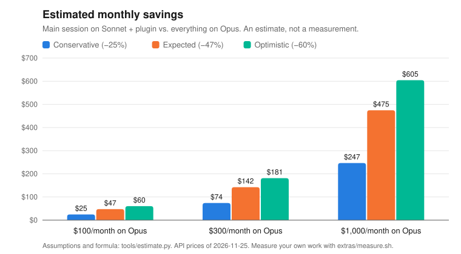

# model-router: full details

[← Back to README](../README.md) · [Italiano](DETAILS.it.md)


<picture>
  <source media="(prefers-color-scheme: dark)" srcset="savings-dark.svg">
  
</picture>

> **This chart is an estimate, not a measurement.** It comes from official API prices and stated assumptions ([how it is computed](#how-the-estimate-is-computed)). Your savings depend on your tasks, so [measure them](#measure-your-own-savings).

## Why

A Claude Code chat can't change its own model halfway through. It can, however, delegate work to **subagents**, and each subagent can run on a fixed model. This plugin adds three of them and a short policy that tells the main session when to use each:

| Agent | Model | Used for | Returns |
|---|---|---|---|
| `model-router:reader` | Haiku | read-only exploration: finding code, tracing flows, summarizing files, logs and docs | conclusions + `file:line` only |
| `model-router:coder` | Sonnet | implementing a clearly specified change and its tests | short report of what changed and what was verified |
| `model-router:architect` | Opus | design, trade-offs, multi-file plans, hard bugs, security | a decision and a step-by-step plan (it never edits files) |

The policy is injected once when a session starts (and again after `/clear` or compaction). It is about 160 words, not a reminder on every prompt. It covers three rules:

- **Small steps stay in the main session.** Each subagent starts cold, so delegating something tiny costs more than doing it.
- **Escalate one level on failure** (reader → coder → architect) instead of retrying the same agent.
- **Briefs and answers stay short.** Agents return conclusions, not file dumps, so the main context stays small.

## Install

Requires Claude Code with plugin support.

```bash
claude plugin marketplace add dimakushniriuk-art/claude-code-model-router
claude plugin install model-router@model-router
```

Or inside Claude Code: `/plugin marketplace add dimakushniriuk-art/claude-code-model-router`, then `/plugin install model-router@model-router`.

Restart Claude Code and run `/agents`: you should see the three `model-router:*` agents.

**Then set Sonnet as your main model.** Use `/model sonnet`, or put `"model": "sonnet"` in `~/.claude/settings.json`. This is the biggest lever: the conversation runs on Sonnet, and Opus is called in through `architect` only when the work needs it. If you keep Opus as the main model, the plugin still moves reading to Haiku, but the estimated saving drops to about 13%.

To try it without installing, clone the repo and run `claude --plugin-dir ./plugins/model-router`.

## Optional extras

**Status line.** Shows model, session cost, context used and cache hit ratio, for example `Sonnet 5.5 | $0.12 | ctx 37% | cache 91%`. Plugins can't set the status line, so it is a manual step, and it needs `jq`.

```bash
cp extras/statusline.sh ~/.claude/statusline.sh && chmod +x ~/.claude/statusline.sh
```

```jsonc
// ~/.claude/settings.json
{ "statusLine": { "type": "command", "command": "~/.claude/statusline.sh" } }
```

**CLAUDE.md habits.** [`extras/CLAUDE.md-snippet.md`](../extras/CLAUDE.md-snippet.md) has general token-saving rules and compaction instructions. Paste it into `~/.claude/CLAUDE.md`.

## Measure your own savings

Run this inside any git repository:

```bash
bash extras/measure.sh "a task you really do, e.g. add input validation to the signup form" 3
```

It runs the same task 3 times per variant, each in a throwaway git worktree, so your working tree is never touched:

- **baseline:** Opus as the main model, every subagent forced onto Opus (no routing)
- **routed:** Sonnet as the main model, with the plugin

It prints cost, turns, time and cost per model for every run. You can change the models with `BASE_MODEL` and `ROUTED_MODEL`. For tasks that run tests, set `PERM=auto`, because `acceptEdits` denies shell commands in non-interactive mode. **Check the quality of both results, not just the price.**

You can also measure by hand: do the same task in two sessions and compare `/usage` at the end.

One real data point: a 5-file toy repository and a single run of a search task cost **$0.23 baseline and $0.085 routed**. Almost all of that saving came from Sonnet replacing Opus as the main model, not from Haiku. One run on a toy repository proves nothing about your workload.

## How the estimate is computed

All of it is in [`tools/estimate.py`](../tools/estimate.py), with no dependencies. Edit the assumptions and run `python3 tools/estimate.py && python3 tools/visuals.py` to redraw the charts.

**Prices** (USD per million tokens, [official pricing page](https://platform.claude.com/docs/en/about-claude/pricing), checked 2026-11-25):

| Model | Input | Cache write (5m) | Cache read | Output |
|---|---|---|---|---|
| Opus 5.5 | 4.00 | 5.00 | 0.20 | 20.00 |
| Sonnet 5.5 | 2.00 | 2.50 | 0.10 | 10.00 |
| Haiku 5.5 (prompts ≤100K) | 0.10 | 0.125 | 0.01 | 0.50 |

**Assumption 1, token mix.** Agentic sessions re-send their context, so tokens are 85% cache reads, 5% cache writes, 3% fresh input and 7% output. With this mix Sonnet costs 0.50× Opus (exactly half in every category) and Haiku about 0.027× Opus.

**Assumption 2, who does the work.** The baseline is everything on Opus. Shares are of the baseline's tokens, and the overhead is extra tokens from subagent cold starts, briefs and summaries:

| Scenario | Sonnet | Haiku | Opus | Overhead | Saving | at $100/mo | at $300/mo | at $1,000/mo |
|---|---|---|---|---|---|---|---|---|
| Conservative | 60% | 10% | 30% | +25% | 25% | $25 | $74 | $247 |
| Expected | 60% | 25% | 15% | +15% | 47% | $47 | $142 | $475 |
| Optimistic | 60% | 35% | 5% | +10% | 60% | $60 | $181 | $605 |
| Opus main + plugin | – | 25% | 75% | +15% | 13% | $13 | $39 | $130 |

Formula: `routed cost = baseline × (Σ share × relative price) × (1 + overhead)`.

**What this does not capture.**
- **Lower quality has a cost.** If Sonnet or Haiku gets something wrong and you redo it, the saving shrinks. The policy escalates to a stronger model on failure for this reason.
- **Context the main session no longer reads is not counted.** That would increase savings, so the estimate is conservative there.
- **Subscriptions.** On a Pro or Max plan you pay a flat fee, so the saving is not money back. It shows up as more work before you reach your usage limits. The dollar figures apply to API (pay-as-you-go) billing.
- **Haiku 5.5 costs 5× more for prompts above 100K tokens.** The reader agent normally stays far below that.

## Customize

- Change `model:` in [`plugins/model-router/agents/*.md`](../plugins/model-router/agents) if an agent struggles, for example `reader: sonnet`. Accepted values are `haiku`, `sonnet`, `opus`, `fable`, `inherit` or a full model ID.
- Edit the delegation policy in [`plugins/model-router/hooks/routing-policy.md`](../plugins/model-router/hooks/routing-policy.md).
- Disable everything with `/plugin`, or with `claude plugin disable model-router`.

## Repository layout

```
.claude-plugin/marketplace.json     marketplace (install source)
plugins/model-router/
  .claude-plugin/plugin.json        plugin manifest
  agents/reader.md coder.md architect.md
  hooks/hooks.json                  SessionStart hook
  hooks/routing-policy.md           the injected policy
extras/statusline.sh                optional status line
extras/measure.sh                   A/B cost measurement
extras/CLAUDE.md-snippet.md         optional CLAUDE.md rules
tools/estimate.py                   savings model + chart generator
tools/visuals.py                    README visuals generator
docs/img/*.svg                      README visuals (EN/IT, light/dark)
docs/savings-*.svg                  detailed scenario chart
```

## References

Claude Code docs: [subagents](https://code.claude.com/docs/en/sub-agents) · [plugins](https://code.claude.com/docs/en/plugins-reference) · [hooks](https://code.claude.com/docs/en/hooks) · [status line](https://code.claude.com/docs/en/statusline) · [managing costs](https://code.claude.com/docs/en/costs) · [API pricing](https://platform.claude.com/docs/en/about-claude/pricing)

This is a community project, not affiliated with or endorsed by Anthropic.

## License

[MIT](../LICENSE)
